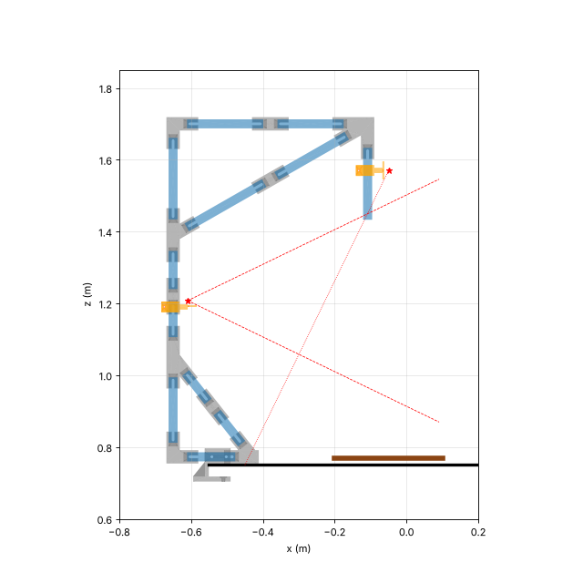

# Documentation for Perspective and AI

Notes for the IP12 group **Perspective and AI**, which has to create the camera stand for the palletising workcell. The first model of the stand was made inside the simulation project (see the rest of this repository).

## First visual model of the stand (v0, concept)

*Side view in the simulation frame (x to the right, z up). Grey = printed corner nodes and couplers, blue = printed bars, orange = camera mounts, red stars = camera centres, brown = pallet, black line = table top.*

### Idea

One rigid stand made of two triangles, clamped to the table's left edge:

* **Lower right triangle:** the base lies on the table, the upright stands 10 cm outside the table edge, the hypotenuse closes it. **Cam 1** (side view) sits on the top of the upright and looks horizontally across the table.
* **Upper inverted triangle:** the upright continues up, a boom runs over the pallet, a brace closes the triangle. A short post hangs from the boom end and carries **Cam 2** (ZED Mini) looking down, 0.8 m above the pallet.

Everything is 3D printed (PETG suggested) from 25 mm hollow bars that push into printed nodes and couplers, one M8 bolt per socket, so the stand is built piece by piece.

### Key numbers (v0)

| Item | Value |
|---|---|
| Table | 1.1 m x 1.1 m, top height 0.75 m (assumed) |
| Upright position | 0.10 m outside the table edge (x = -0.65 m) |
| Base / upright / hypotenuse (lower triangle) | 0.22 m / 0.28 m / 0.35 m |
| Boom (upper triangle) | 0.54 m, brace 0.62 m |
| Cam 1 | 1.208 m high, looks along +X (placeholder camera, model not chosen) |
| Cam 2 | ZED Mini, 0.8 m above the pallet, looks down |

### Status and open points

* v0 is a **concept**: geometry and printable parts exist (`simulation/irb1100_vision/cad/truss_stand.py`, STL/STEP in `simulation/irb1100_vision/meshes/stand_*`), but **nothing has been printed or tested**.
* To improve: better looks, best printing orientation and splitting of parts, fit and tolerances, stiffness (planar truss is weaker sideways), final table height, Cam 1 model.
* **Dropped on 22 Nov 2026:** the cell now uses only the ZED Mini on the wrist mount ([zed_wrist/](../zed_wrist/README.md)). The stand, Cam 1 and Cam 2 were removed from the simulation; their files (`cad/truss_stand.py`, `meshes/stand_*`, `docs/STAND.md`) are still in the git history.
* How to run the simulation: [README](../README.md).

### Change log

| Version | What |
|---|---|
| v0 | First triangle-truss concept inside the simulation model |
