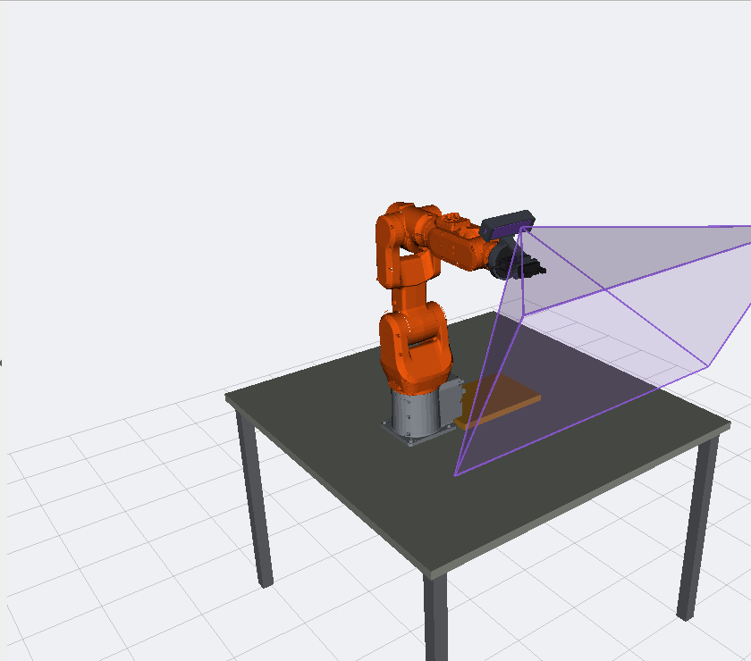
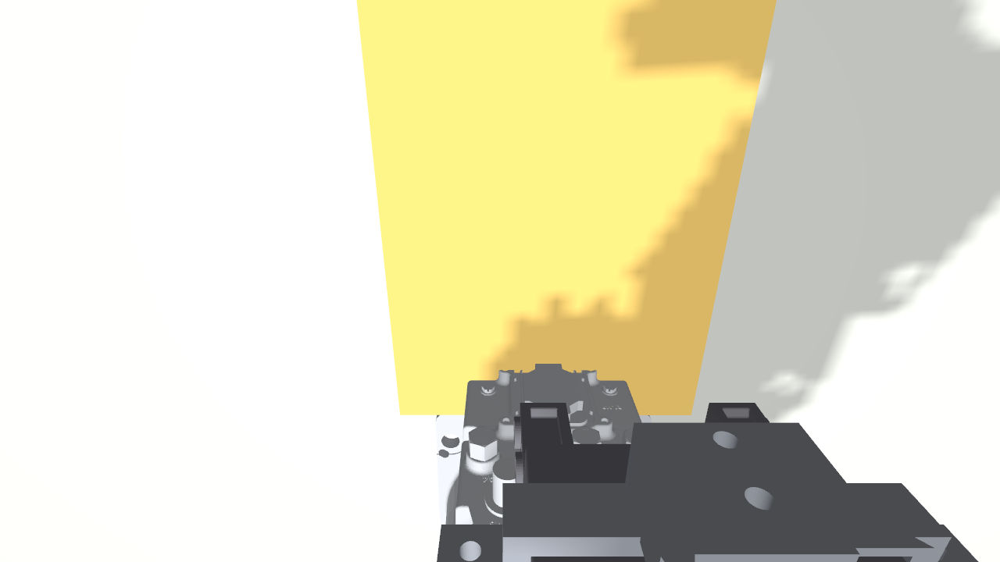
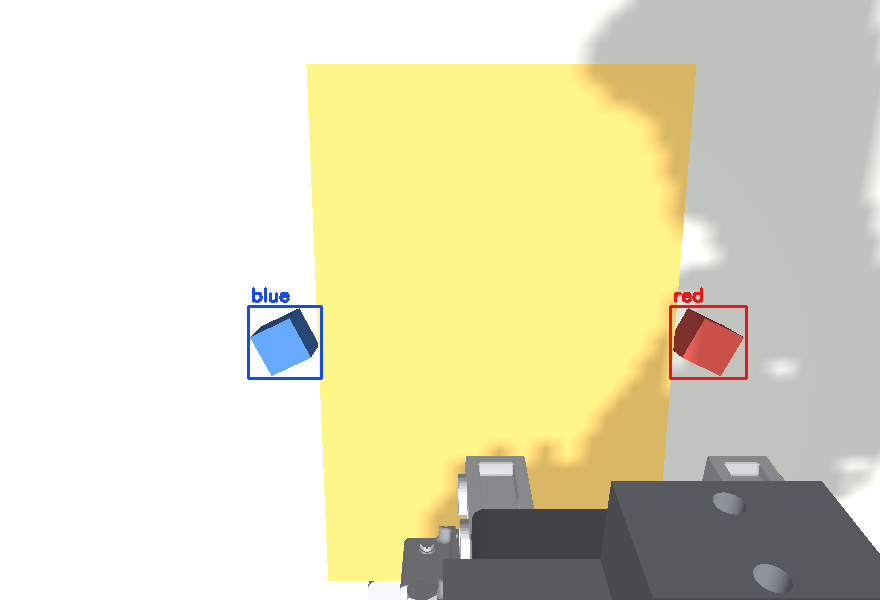
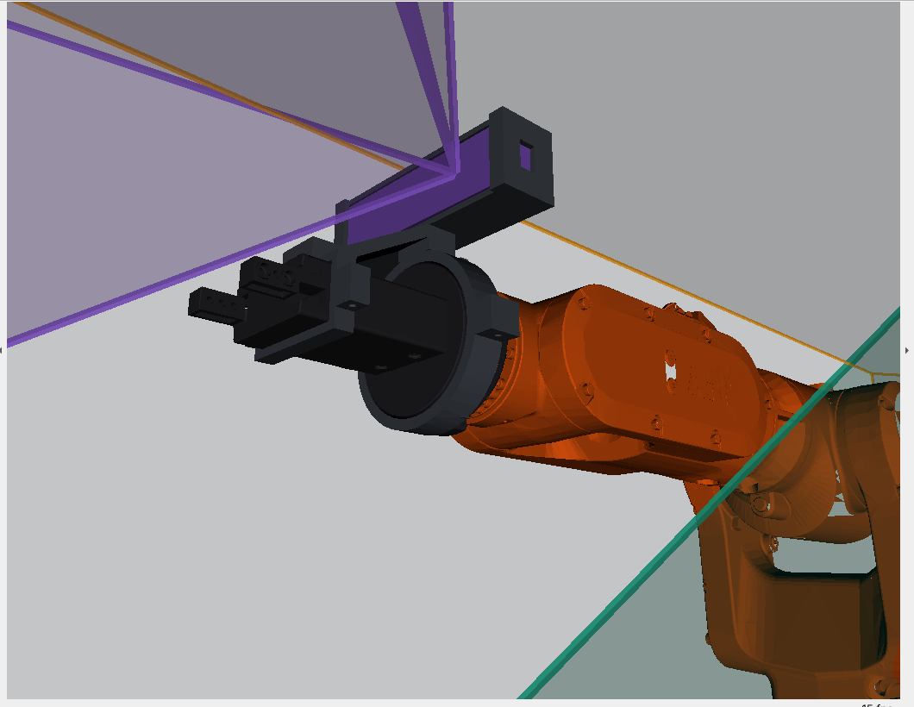
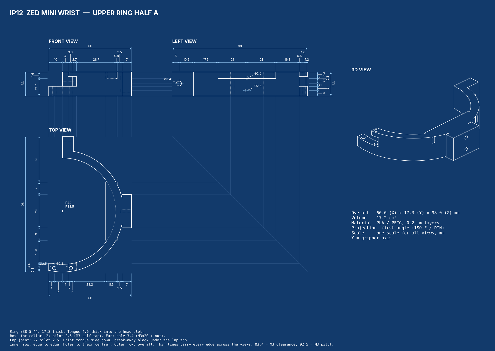
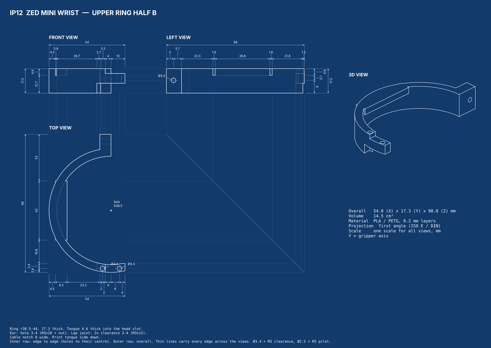
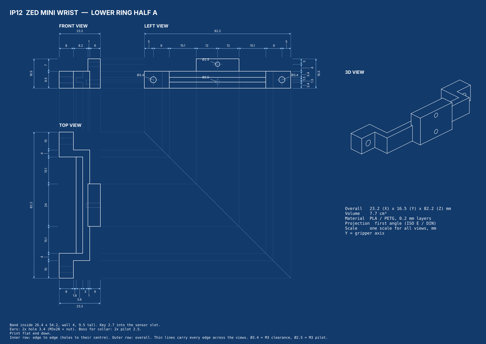

# IP12 ABB IRB 1100 simulation (RViz2 + Gazebo)

[](../../actions/workflows/check-model.yml)

ROS 2 Jazzy workcell for the **IP12 palletising project** (HSRW): an ABB IRB 1100 robot with a Zimmer gripper,
a square table and one camera: a ZED Mini on a 3D-printed mount on the gripper (wrist camera). It is used to check the camera view
and to move the arm in simulation before the real setup is built.



## What is inside

| Part | Source |
|---|---|
| ABB IRB 1100-4/0.58 (OmniCore) arm, 6 joints, ABB axis limits | ABB official CAD (STEP, rev04), converted to meshes |
| Zimmer LWR50L-23-00006-A gripper | Zimmer CAD (STEP) for the look, datasheet numbers for collision and mass |
| Table 1.1 m x 1.1 m, pallet | measured / assumed (see limits) |
| Launch files, controllers, camera bridge | this project |
| 3D-printed ZED Mini wrist mount for the real LWR50L-23-00006-A gripper (7 parts, camera tilted 25 deg); in the simulation it is the wrist camera `cam3`, with Gazebo pictures | designed in this project, see [zed_wrist/](zed_wrist/README.md) |

```
simulation/irb1100_vision/   ROS 2 package (ament_cmake)
  urdf/        workcell, arm, gripper, wrist camera (xacro)
  launch/      display.launch.py (RViz2), gazebo.launch.py (Gazebo + RViz2)
  config/      ros2_control controllers, ROS<->Gazebo bridge
  meshes/      ABB arm meshes, Zimmer gripper, ZED wrist mount (STL)
  scripts/     fov_markers.py (view cones), check_urdf.py (model check)
  worlds/      Gazebo world
docs/          SIMULATION.md / SIMULATION.pdf (full description)
zed_wrist/     printable ZED Mini wrist mount: STL/STEP parts, print plate, blueprints, build123d scripts
```

## Requirements

- Ubuntu 24.04 (native or WSL2 on Windows 11 with WSLg for windows)
- ROS 2 **Jazzy** and Gazebo **Harmonic**
- A graphics driver that works in WSL/Linux. Gazebo runs at a low real-time factor on weak GPUs (about 8 % was seen on a laptop).
- Packages:

```bash
sudo apt install -y ros-jazzy-rviz2 ros-jazzy-xacro ros-jazzy-robot-state-publisher \
  ros-jazzy-joint-state-publisher-gui python3-colcon-common-extensions
# for Gazebo:
sudo apt install -y ros-jazzy-ros-gz ros-jazzy-gz-ros2-control \
  ros-jazzy-ros2-control ros-jazzy-ros2-controllers
```

## Install and run

```bash
mkdir -p ~/ros2_ws/src && cd ~/ros2_ws/src
git clone https://github.com/PhamAnhHoangg/IP12-ABB-IRB1100-Simulation.git
cp -r IP12-ABB-IRB1100-Simulation/simulation/irb1100_vision .
cd ~/ros2_ws && source /opt/ros/jazzy/setup.bash
colcon build --packages-select irb1100_vision && source install/setup.bash

ros2 launch irb1100_vision display.launch.py     # RViz2 only: robot, table, wrist camera view cone, joint sliders
ros2 launch irb1100_vision gazebo.launch.py      # Gazebo + RViz2 with the wrist camera pictures
```

Move the arm in Gazebo (joint targets in radians, 4 s):

```bash
ros2 topic pub --once /arm_controller/joint_trajectory trajectory_msgs/msg/JointTrajectory \
 "{joint_names: [joint_1,joint_2,joint_3,joint_4,joint_5,joint_6], points: [{positions: [0.0,0.4,0.3,0.0,0.6,0.0], time_from_start: {sec: 4}}]}"
```

Camera topics (wrist ZED Mini): `/cam3/left/image_raw`, `/cam3/right/image_raw` (+ `camera_info`). `stereo:=false` drops the right eye, `lite:=true` makes the pictures 640x360 at 10 fps.

What the wrist camera sees with the gripper over the pallet (Gazebo, left eye): the jaws at the bottom of the picture, the pallet ahead.



## Boxes, gripper, depth, detection, dataset, calibration (Gazebo)

The world has three 25 mm boxes on the table (red, blue, green) and the gripper jaws really open and close.
`sequence:=true` plays the palletising order: pick red, place it on the pallet, pick blue, stack it on red.

| What | How |
|---|---|
| Gripper | `ros2 topic pub --once /gripper/command std_msgs/msg/String "{data: close}"` (or `open`). Closing within 30 mm of a box grips it (Gazebo DetachableJoint, the box follows the jaws); `/gripper/holding` says which box. The panel has close/open buttons too. |
| Depth (left eye) | `/cam3/depth/image_raw` (32FC1, metres) and point cloud `/cam3/points` (frame `cam3_left_cloud_frame`, shown in RViz2) |
| Box positions (truth) | `/sim/box_red/pose`, `/sim/box_blue/pose`, `/sim/box_green/pose` |
| Box detector | starts with the launch (`detect:=false` turns it off). Colour detection, depth at the box centre, then TF to the world frame: `/cam3/detections` (PoseArray, world), `/cam3/detections/markers` (cubes in RViz2), `/cam3/detections/image`. It logs the error against the truth: 1 to 3 mm when the arm is still. Give it YOLO weights with `-p model:=best.pt` (needs `pip install ultralytics`). |
| YOLO dataset | `ros2 run irb1100_vision make_dataset.py --ros-args -p count:=300 -p out:=$HOME/ip12_dataset` moves the boxes and the arm to random spots and writes images + labels (boxes hidden behind others are left out). Then `yolo detect train data=$HOME/ip12_dataset/dataset.yaml model=yolov8n.pt` |
| Hand-eye calibration | `ros2 run irb1100_vision handeye_calib.py` puts a checkerboard (9 x 6 squares of 20 mm) on the pallet, takes 15 views and runs `cv2.calibrateHandEye`. In Gazebo it finds the camera within about 1 mm and 0.3 deg of the CAD value and writes `~/ip12_handeye.yaml`. On the real robot the same steps give the real camera position for `urdf/zed_wrist.xacro`. |
| ArUco camera position | `ros2 run irb1100_vision aruco_locate.py` with the arm looking at the ArUco marker on the table (ID 0, DICT_4X4_50, 50 mm). From the marker's known place and its 4 corners in the picture (`solvePnP`) it works out where the camera is in robot coordinates, and where it sits on the gripper, from a single picture. In Gazebo: about 5 mm and 0.4 deg from the true value (one small marker; the checkerboard with many views is more exact). For the real cell print [`docs/print/aruco_id0_DICT_4X4_50.pdf`](docs/print/aruco_id0_DICT_4X4_50.pdf) (page 1: 50 mm, page 2: 100 mm, more exact) at 100 % and pass `-p side:=... -p marker_xyz:="[x, y, z]" -p marker_yaw:=...` with the measured marker place. |
| Boxes from the point cloud | `ros2 run irb1100_vision cloud_boxes.py` finds the boxes by shape alone (no colour, no model): point cloud to world frame, height map, flat box-sized patches. Gives centre and yaw on `/cam3/cloud_boxes`. In Gazebo: 0 to 1 mm and 1 to 2 deg off. |

What the perception side and the robot driver agree on (topics, frames, units) is in [`docs/INTERFACE.md`](docs/INTERFACE.md).

What the detector sees with the arm over the pallet (Gazebo, left eye):



## Run on Windows, macOS or Linux (Docker, no ROS install)

The project is developed on Ubuntu 24.04 (ROS 2 Jazzy officially supports Ubuntu and Windows, macOS only as tier 3).
For macOS (Intel and Apple Silicon) or any machine without Ubuntu, use the Docker image in `docker/`.
Status: builds and starts the browser desktop on Windows (Docker Desktop, tested by the team); every change is also checked in CI (build + RViz2/Gazebo launch test). Please report problems.

1. Install Docker Desktop (Windows, macOS or Linux) and start it.
2. In a terminal:
   ```bash
   git clone https://github.com/PhamAnhHoangg/IP12-ABB-IRB1100-Simulation.git
   cd IP12-ABB-IRB1100-Simulation
   docker compose -f docker/docker-compose.yml up --build -d
   docker compose -f docker/docker-compose.yml exec ip12 bash
   ```
   The first build downloads about 4 GB and takes 5-15 minutes. The many `Failed to read: session...` and `xkbcomp` lines in the log are harmless.
3. Open `http://localhost:6080/vnc.html` in your browser and click Connect. This is the screen of the container (empty at first).
4. In the container shell from step 2:
   ```bash
   ros2 launch irb1100_vision gazebo.launch.py lite:=true stereo:=false   # Gazebo + wrist camera picture (light)
   ros2 launch irb1100_vision display.launch.py                           # or RViz2 only, fast
   ```
   RViz2, Gazebo and the arm panel open in the browser tab after 1-2 minutes.
5. Stop: `exit` the shell, then `docker compose -f docker/docker-compose.yml down`. Next time `up -d` without `--build` starts in seconds
   (use `--build` again after `git pull`).

Notes: there is no GPU inside the container, so everything is rendered by the CPU and Gazebo will be slow. RViz2 works best.
iPhone and iPad cannot run Docker or ROS 2; they can only open results (videos, screenshots) or the browser desktop of a PC/Mac on the same network.

## Record the cameras (for the ML / UI group)

With Gazebo running, record the two wrist camera streams (left, right) to a rosbag2 file that anyone can replay without Gazebo:

```bash
./simulation/irb1100_vision/scripts/record_cameras.sh        # stop with Ctrl+C
ros2 bag play cameras_<date>                                 # replay
```

The bag can also be opened in Foxglove (free, runs in the browser or as an app on Windows, macOS and Linux).
Simulator images are for testing the pipeline only; training images must come from the real ZED M.

## ZED Mini wrist mount (3D printed)

A seven-part mount that clamps the ZED Mini onto the gripper: the upper ring locks into the side slots of the gripper head,
the lower ring keys into the sensor slots of the body, and a collar with a 25 deg tilt wedge carries the camera box, so the camera sees the jaws and fingers too. Files, screw list, assembly
steps and print settings are in [zed_wrist/README.md](zed_wrist/README.md).


In the simulation the mount and the camera sit on the real gripper model as `cam3`, with its view cone (purple) in RViz2:



Wrist clearance (simulation, gripper mounted straight on the flange): the camera box stays clear of the forearm for
joint_5 between about -90 and +100 deg at any joint_6 angle. Past that it can touch the forearm at some joint_6 angles
(the bare gripper alone is clear to about +-110 deg). The real LWR50F head moves everything further out, so the real limit is a bit wider.

| | |
|---|---|
|  |  |
|  |  |
|  |  |
|  | |

## Testing

| Check | What it covers | Where it runs |
|---|---|---|
| `python3 simulation/irb1100_vision/scripts/check_urdf.py` (needs only `pip install xacro`) | model expands, all meshes exist, six joints with ABB limits, tool/gripper/camera frames exist, no orphan links, wrist camera has its Gazebo sensors | on every push via GitHub Actions ([`check-model.yml`](.github/workflows/check-model.yml)) |
| RViz2 launch | RViz2 and robot_state_publisher start and stay up, joint states are published | automatically in the Docker image on a virtual screen ([`launch_smoke_test.sh`](simulation/irb1100_vision/scripts/launch_smoke_test.sh), run by [`docker-build.yml`](.github/workflows/docker-build.yml)); what the picture looks like is still checked by hand |
| Gazebo launch | model spawns, `joint_state_broadcaster`, `arm_controller` and `gripper_controller` start, the arm moves to a commanded pose, the wrist camera sends a picture, the depth point cloud and box detections come out | automatically, same script (Gazebo server only, light cameras); the Gazebo window and full-size cameras are still checked by hand |
| `colcon build` in ROS 2 Jazzy, installed model through `xacro` + `check_urdf` (ROS URDF parser), launch files and scripts compile, the point-cloud box finder on a made-up cloud ([`test_cloud_boxes.py`](simulation/irb1100_vision/test/test_cloud_boxes.py)) | the package really builds and installs, not only the source files | on every change in `simulation/` ([`ros2-build.yml`](.github/workflows/ros2-build.yml)) |
| Docker image build | `docker/Dockerfile` builds and the package is installed inside it | on every change in `docker/` or `simulation/` ([`docker-build.yml`](.github/workflows/docker-build.yml)) |
| README links | every picture and file linked from a README exists (repo files only, outside websites not checked) | on every change in a `.md` file ([`check-links.yml`](.github/workflows/check-links.yml)) |
| `python3 zed_wrist/zed_wrist_parts.py` (needs `pip install build123d`) | rebuilds the 7 wrist parts, checks they fit the gripper slots and do not hit the gripper while sliding on, no overlaps between parts | on every change in `zed_wrist/` via GitHub Actions ([`check-zed-wrist.yml`](.github/workflows/check-zed-wrist.yml)) |

Run the launch test yourself: `docker compose -f docker/docker-compose.yml run --rm --entrypoint bash ip12 /root/ros2_ws/src/irb1100_vision/scripts/launch_smoke_test.sh`

**Print files for download:** push a version tag (`git tag v1.0 && git push origin v1.0`) and the
[`release-print-files.yml`](.github/workflows/release-print-files.yml) Action puts a zip with all STL/3MF/STEP files and blueprints on the Releases page.

## Known limits

- Table top height (0.75 m), pallet size and position, base variant (STD vs BTM) are assumptions.
- Gripper looks like the real CAD but collides as simple boxes; no fingers, LWR50F head between flange and gripper not modelled. Gripping uses a Gazebo joint that snaps the box to the gripper, so grip force and slipping are not simulated.
- Wrist camera pictures and depth are plain Gazebo renders (no lens distortion, no noise, perfect depth from the left eye instead of ZED stereo matching). A YOLO model trained only on them will need real ZED pictures added before it works on the real cell.
- Link masses, inertia and torque limits are estimates, so Gazebo dynamics are only roughly right.
- No inverse kinematics or MoveIt, no connection to the real OmniCore controller.
- OmniCore E10 controller box is not modelled.

More detail: [`docs/SIMULATION.md`](docs/SIMULATION.md) ([PDF](docs/SIMULATION.pdf), older, still shows the removed camera stand).

## Credits and sources

- **ABB**: IRB 1100 robot and CAD model, downloaded from ABB's website: *CAD models, STEP, IRB 1100, 4-580, OmniCore, rev04, comp*,
  product page <https://new.abb.com/products/robotics/nl/onze-robots/articulated-robots/irb-1100>.
  The arm meshes in this repo are derived from that CAD model. Robot data sheet: <https://library.e.abb.com/public/6810bdc2bc0744edb5f050a6494daaea/Datenblatt_IRB1100_lowres.pdf>.
  All rights to the ABB robot and its CAD model belong to ABB.
- **Zimmer Group**: datasheet for MATCH LWR50L-23-00006-A (dimensions, mass, jaw stroke).
- **Zimmer Group**: CAD model of MATCH LWR50L-23-00006-A (the gripper on the real robot), downloaded from zimmer-group.com, in `zed_wrist/`. Used to fit the 3D-printed ZED wrist mount and as the gripper look in the simulation (`meshes/zimmer_lwr50l.stl`). All rights to the gripper and its CAD model belong to Zimmer Group.
- **Stereolabs**: ZED Mini datasheet (size, baseline, field of view).
- **Open Robotics / ROS 2 community**: ROS 2 Jazzy, RViz2, ros2_control, gz_ros2_control, ros_gz, Gazebo Harmonic.
- Python tools used for the mesh and mount work: build123d, trimesh, yourdfpy, numpy, Pillow.
- Project: HSRW IP12 palletising with AI perception. Repository owner: PhamAnhHoangg.
- Author: Pham Anh Hoang (GitHub: [PhamAnhHoangg](https://github.com/PhamAnhHoangg))
- AI assistance tool: Claude Sonnet 5.5 (Anthropic)

## License and third-party material

No license has been chosen yet. Third-party material belongs to its owners and is credited above: the ABB IRB 1100 CAD model
(source link above), the Zimmer LWR50L dimensions and LWR50L-23-00006-A CAD model, and the Stereolabs ZED Mini dimensions. The ABB-derived meshes are used here for the
HSRW IP12 university project, with ABB credited as the source.
