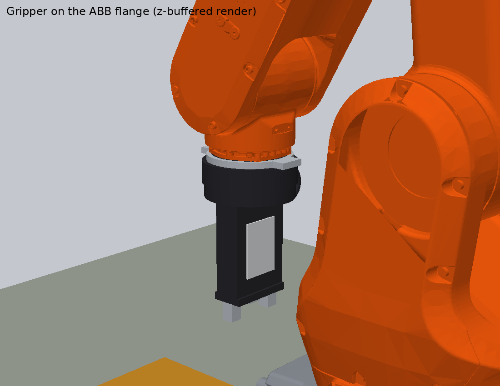
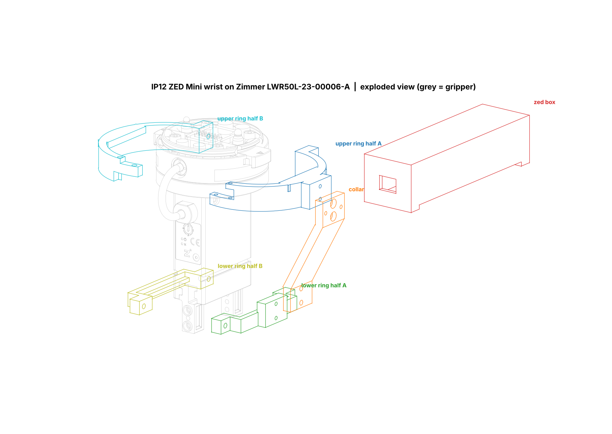
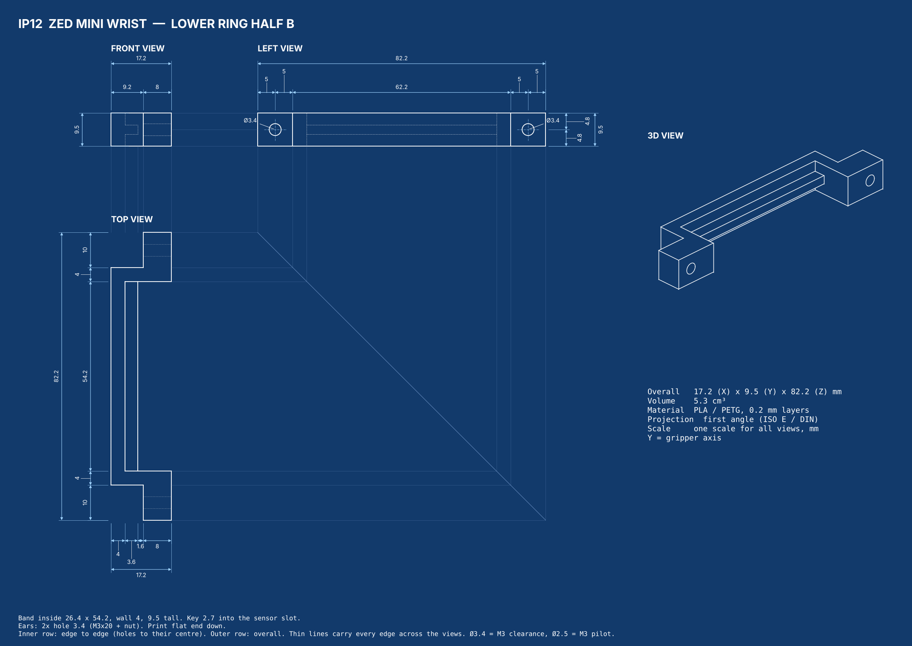
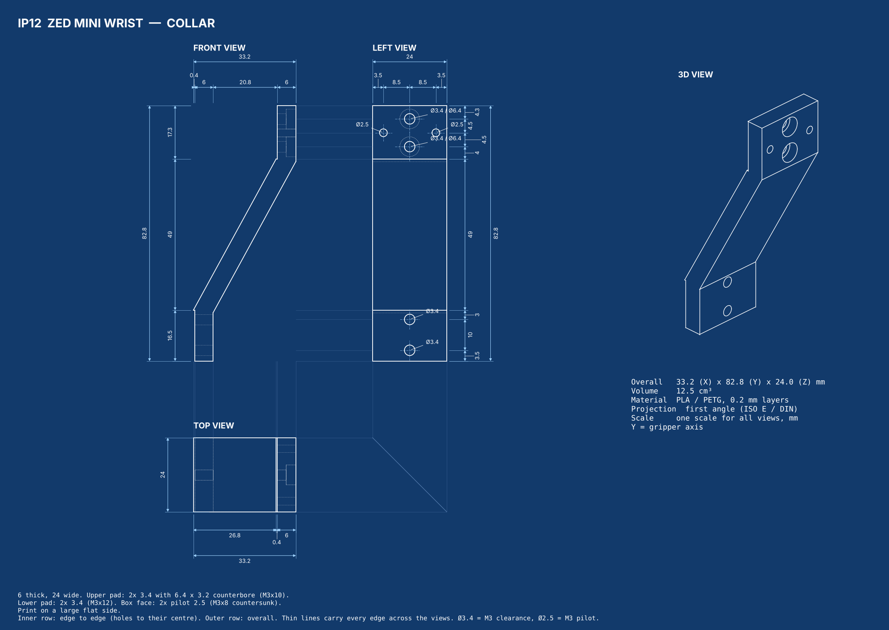
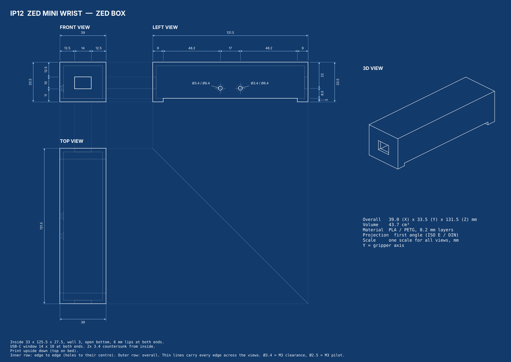

# IP12 ABB IRB 1100 simulation (RViz2 + Gazebo)

[](../../actions/workflows/check-model.yml)

ROS 2 Jazzy workcell for the **IP12 palletising project** (HSRW): an ABB IRB 1100 robot with a Zimmer gripper,
a square table and two cameras. It is used to plan the camera placement and to move the arm in simulation
before the real setup is built.



## What is inside

| Part | Source |
|---|---|
| ABB IRB 1100-4/0.58 (OmniCore) arm, 6 joints, ABB axis limits | ABB official CAD (STEP, rev04), converted to meshes |
| Zimmer LWR50L-23-00006-A gripper | Zimmer CAD (STEP) for the look, datasheet numbers for collision and mass |
| Table 1.1 m x 1.1 m, pallet | measured / assumed (see limits) |
| All-printed triangle truss camera stand (Cam 1 side, Cam 2 ZED Mini top-down) | designed in this project, see [docs/STAND.md](docs/STAND.md) |
| Launch files, controllers, camera bridges | this project |
| 3D-printed ZED Mini wrist mount for the real LWR50L-23-00006-A gripper (6 parts), also shown on the robot in RViz2 (Cam 3) | designed in this project, see [zed_wrist/](zed_wrist/README.md) |

```
simulation/irb1100_vision/   ROS 2 package (ament_cmake)
  urdf/        workcell, arm, gripper, cameras (xacro)
  launch/      display.launch.py (RViz2), gazebo.launch.py (Gazebo + RViz2)
  config/      ros2_control controllers, ROS<->Gazebo bridge
  meshes/      ABB arm meshes, camera mounts, printed stand parts (STL/STEP)
  cad/         scripts that generate the printable mounts and arms (build123d)
  scripts/     fov_markers.py (view cones), check_urdf.py (model check)
  worlds/      Gazebo world
docs/          SIMULATION.md / SIMULATION.pdf (full description)
zed_wrist/     printable ZED Mini wrist mount: STL/STEP parts, print plate, blueprints, build123d scripts
```

## Requirements

- Ubuntu 24.04 (native or WSL2 on Windows 11 with WSLg for windows)
- ROS 2 **Jazzy** and Gazebo **Harmonic**
- A graphics driver that works in WSL/Linux. Gazebo runs at a low real-time factor on weak GPUs (about 8 % was seen on a laptop).
- Packages:

```bash
sudo apt install -y ros-jazzy-rviz2 ros-jazzy-xacro ros-jazzy-robot-state-publisher \
  ros-jazzy-joint-state-publisher-gui python3-colcon-common-extensions
# for Gazebo:
sudo apt install -y ros-jazzy-ros-gz ros-jazzy-gz-ros2-control \
  ros-jazzy-ros2-control ros-jazzy-ros2-controllers
```

## Install and run

```bash
mkdir -p ~/ros2_ws/src && cd ~/ros2_ws/src
git clone https://github.com/PhamAnhHoangg/IP12-ABB-IRB1100-Simulation.git
cp -r IP12-ABB-IRB1100-Simulation/simulation/irb1100_vision .
cd ~/ros2_ws && source /opt/ros/jazzy/setup.bash
colcon build --packages-select irb1100_vision && source install/setup.bash

ros2 launch irb1100_vision display.launch.py     # RViz2 only: robot, table, view cones, joint sliders
ros2 launch irb1100_vision gazebo.launch.py      # Gazebo + RViz2 with the camera pictures
```

Move the arm in Gazebo (joint targets in radians, 4 s):

```bash
ros2 topic pub --once /arm_controller/joint_trajectory trajectory_msgs/msg/JointTrajectory \
 "{joint_names: [joint_1,joint_2,joint_3,joint_4,joint_5,joint_6], points: [{positions: [0.0,0.4,0.3,0.0,0.6,0.0], time_from_start: {sec: 4}}]}"
```

Camera topics: `/cam1/image_raw`, `/cam2/left/image_raw`, `/cam2/right/image_raw` (+ `camera_info`).

## Run on Windows, macOS or Linux (Docker, no ROS install)

The project is developed on Ubuntu 24.04 (ROS 2 Jazzy officially supports Ubuntu and Windows, macOS only as tier 3).
For macOS (Intel and Apple Silicon) or any machine without Ubuntu, use the Docker image in `docker/`.
Status: the image builds and installs the package on every change (checked by the Docker build Action); running RViz2/Gazebo inside it is **not yet tested by the team** - please report problems.

1. Install Docker Desktop (Windows, macOS or Linux) and start it.
2. In a terminal:
   ```bash
   git clone https://github.com/PhamAnhHoangg/IP12-ABB-IRB1100-Simulation.git
   cd IP12-ABB-IRB1100-Simulation
   docker compose -f docker/docker-compose.yml up --build -d
   docker compose -f docker/docker-compose.yml exec ip12 bash
   ```
3. Open `http://localhost:6080/vnc.html` in your browser and click Connect. This is the screen of the container.
4. In the container terminal: `ros2 launch irb1100_vision display.launch.py` (RViz2) or `gazebo.launch.py` (Gazebo).

Notes: there is no GPU inside the container, so everything is rendered by the CPU and Gazebo will be slow. RViz2 works best.
iPhone and iPad cannot run Docker or ROS 2; they can only open results (videos, screenshots) or the browser desktop of a PC/Mac on the same network.

## Record the cameras (for the ML / UI group)

With Gazebo running, record the three camera streams to a rosbag2 file that anyone can replay without Gazebo:

```bash
./simulation/irb1100_vision/scripts/record_cameras.sh        # stop with Ctrl+C
ros2 bag play cameras_<date>                                 # replay
```

The bag can also be opened in Foxglove (free, runs in the browser or as an app on Windows, macOS and Linux).
Simulator images are for testing the pipeline only; training images must come from the real ZED M.

## Cam 1 tilt options

Cam 1 tracks the robot arm. It looks horizontally today, which loses the gripper tip when the arm works low over the pallet.
The tilt can be changed without editing the model; pick an option in `simulation/irb1100_vision/config/cam1_poses/`
and look at the "Cam 1 front" picture in RViz2 while moving the joint sliders:

```bash
ros2 launch irb1100_vision display.launch.py cam1_tilt_deg:=15      # 0, 15, 20 or 30
python3 simulation/irb1100_vision/scripts/check_cam_view.py 0 15 20 30   # coverage estimate, no ROS needed
```

| Tilt | Gripper tip in view | Wrist in view | Note |
|---|---|---|---|
| 0 deg (now) | 28 % | 89 % | |
| 15 deg | 85 % | 97 % | best balance in the estimate |
| 20 deg | 95 % | 83 % | |
| 30 deg | 99 % | 58 % | |

**Interactive viewer:** open `docs/cam1_viewer.html` in any browser (no install, also works on macOS), click a tilt and an arm pose and the Cam 1 picture changes at once.
Sheet with all tilts: [docs/img/cam1_options.png](docs/img/cam1_options.png)
(software render, made with `scripts/render_cam1_options.py`; it shows framing only, not real image quality).

Estimate from about 1600 random arm poses (script version with fixed samples; tilts 5, 10, 25, 35 are in the viewer too) with the gripper over the pallet (link origins only). The team decides; the printed mount for the chosen tilt is still to be made.

## ZED Mini wrist mount (3D printed)

A six-part mount that clamps the ZED Mini onto the gripper: the upper ring locks into the side slots of the gripper head,
the lower ring keys into the sensor slots of the body, and a collar carries the camera box. Files, screw list, assembly
steps and print settings are in [zed_wrist/README.md](zed_wrist/README.md).



In the simulation (RViz2) the mount and the camera sit on the real gripper model as Cam 3, with its view cone (purple):


Wrist clearance (simulation, gripper mounted straight on the flange): the camera box stays clear of the forearm for
joint_5 between about -85 and +95 deg at any joint_6 angle. Past that it can touch the forearm at some joint_6 angles
(the bare gripper alone is clear to about +-110 deg). The real LWR50F head moves everything further out, so the real limit is a bit wider.

| | |
|---|---|
|  |  |
|  |  |
|  |  |

## Testing

| Check | What it covers | Where it runs |
|---|---|---|
| `python3 simulation/irb1100_vision/scripts/check_urdf.py` (needs only `pip install xacro`) | model expands, all meshes exist, six joints with ABB limits, tool/gripper/camera frames exist, no orphan links, Gazebo-needed camera joints kept | on every push via GitHub Actions ([`check-model.yml`](.github/workflows/check-model.yml)) |
| RViz2 launch | RViz2 and robot_state_publisher start and stay up, joint states are published | automatically in the Docker image on a virtual screen ([`launch_smoke_test.sh`](simulation/irb1100_vision/scripts/launch_smoke_test.sh), run by [`docker-build.yml`](.github/workflows/docker-build.yml)); what the picture looks like is still checked by hand |
| Gazebo launch | model spawns, `joint_state_broadcaster` and `arm_controller` start, the arm moves to a commanded pose, Cam 1 sends a picture | automatically, same script (Gazebo server only, light cameras); the Gazebo window and full-size cameras are still checked by hand |
| `colcon build` in ROS 2 Jazzy, installed model through `xacro` + `check_urdf` (ROS URDF parser), launch files and scripts compile | the package really builds and installs, not only the source files | on every change in `simulation/` ([`ros2-build.yml`](.github/workflows/ros2-build.yml)) |
| Docker image build | `docker/Dockerfile` builds and the package is installed inside it | on every change in `docker/` or `simulation/` ([`docker-build.yml`](.github/workflows/docker-build.yml)) |
| README links | every picture and file linked from a README exists (repo files only, outside websites not checked) | on every change in a `.md` file ([`check-links.yml`](.github/workflows/check-links.yml)) |
| `python3 zed_wrist/zed_wrist_parts.py` (needs `pip install build123d`) | rebuilds the 6 wrist parts, checks they fit the gripper slots and do not hit the gripper while sliding on, no overlaps between parts | on every change in `zed_wrist/` via GitHub Actions ([`check-zed-wrist.yml`](.github/workflows/check-zed-wrist.yml)) |

Run the launch test yourself: `docker compose -f docker/docker-compose.yml run --rm --entrypoint bash ip12 /root/ros2_ws/src/irb1100_vision/scripts/launch_smoke_test.sh`

**Print files for download:** push a version tag (`git tag v1.0 && git push origin v1.0`) and the
[`release-print-files.yml`](.github/workflows/release-print-files.yml) Action puts a zip with all STL/3MF/STEP files and blueprints on the Releases page.

## Known limits

- Table top height (0.75 m), pallet size and position, base variant (STD vs BTM) are assumptions.
- Cam 1 is a 90 x 25 x 25 mm placeholder, camera model not chosen. Cam 1 is level, 1.208 m high.
- Gripper looks like the real CAD but collides as simple boxes; jaws are fixed open, no fingers, LWR50F head between flange and gripper not modelled.
- Cam 3 (ZED Mini on the wrist) is shown in RViz2 with its view cone, but has no Gazebo camera sensor yet (no pictures).
- Link masses, inertia and torque limits are estimates, so Gazebo dynamics are only roughly right.
- No inverse kinematics or MoveIt, no connection to the real OmniCore controller.
- OmniCore E10 controller box is not modelled.

More detail: [`docs/SIMULATION.md`](docs/SIMULATION.md) ([PDF](docs/SIMULATION.pdf)).

## Credits and sources

- **ABB**: IRB 1100 robot and CAD model, downloaded from ABB's website: *CAD models, STEP, IRB 1100, 4-580, OmniCore, rev04, comp*,
  product page <https://new.abb.com/products/robotics/nl/onze-robots/articulated-robots/irb-1100>.
  The arm meshes in this repo are derived from that CAD model. Robot data sheet: <https://library.e.abb.com/public/6810bdc2bc0744edb5f050a6494daaea/Datenblatt_IRB1100_lowres.pdf>.
  All rights to the ABB robot and its CAD model belong to ABB.
- **Zimmer Group**: datasheet for MATCH LWR50L-23-00006-A (dimensions, mass, jaw stroke).
- **Zimmer Group**: CAD model of MATCH LWR50L-23-00006-A (the gripper on the real robot), downloaded from zimmer-group.com, in `zed_wrist/`. Used to fit the 3D-printed ZED wrist mount and as the gripper look in the simulation (`meshes/zimmer_lwr50l.stl`). All rights to the gripper and its CAD model belong to Zimmer Group.
- **Stereolabs**: ZED Mini datasheet (size, baseline, field of view).
- **Open Robotics / ROS 2 community**: ROS 2 Jazzy, RViz2, ros2_control, gz_ros2_control, ros_gz, Gazebo Harmonic.
- Python tools used for the mesh and mount work: build123d, trimesh, yourdfpy, numpy, Pillow.
- Project: HSRW IP12 palletising with AI perception. Repository owner: PhamAnhHoangg.
- Author: Pham Anh Hoang (GitHub: [PhamAnhHoangg](https://github.com/PhamAnhHoangg))
- AI assistance tool: Claude Sonnet 5.5 (Anthropic)

## License and third-party material

No license has been chosen yet. Third-party material belongs to its owners and is credited above: the ABB IRB 1100 CAD model
(source link above), the Zimmer LWR50L dimensions and LWR50L-23-00006-A CAD model, and the Stereolabs ZED Mini dimensions. The ABB-derived meshes are used here for the
HSRW IP12 university project, with ABB credited as the source.
