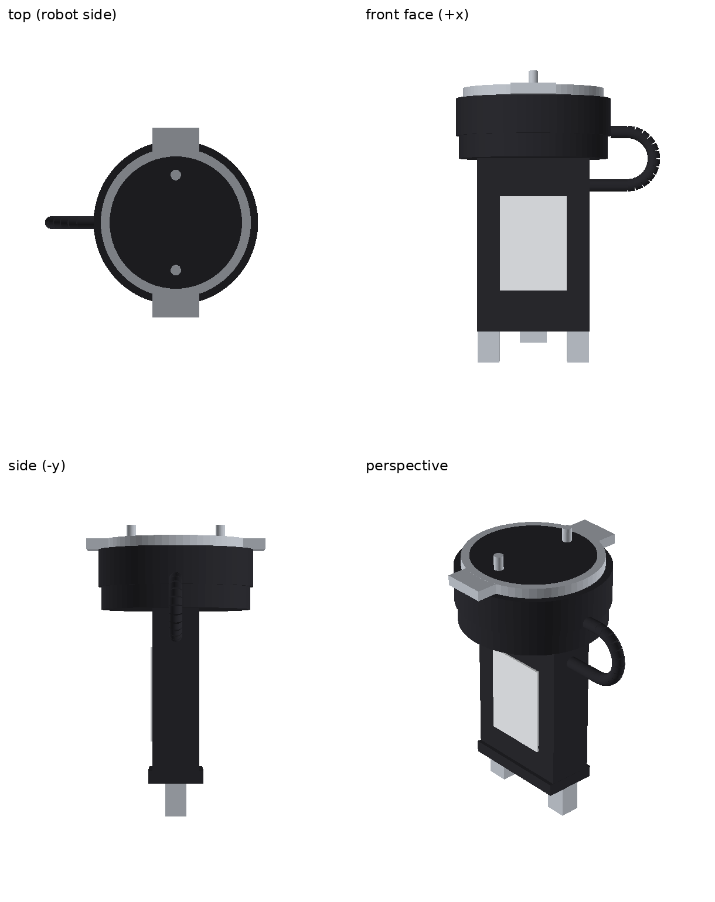
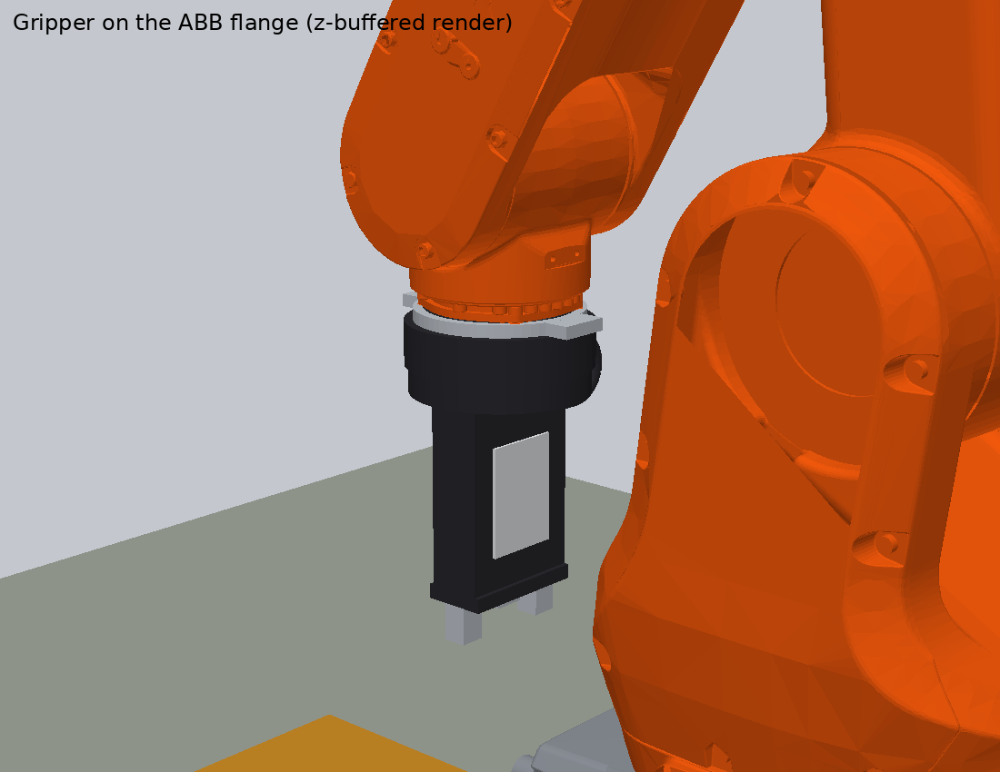
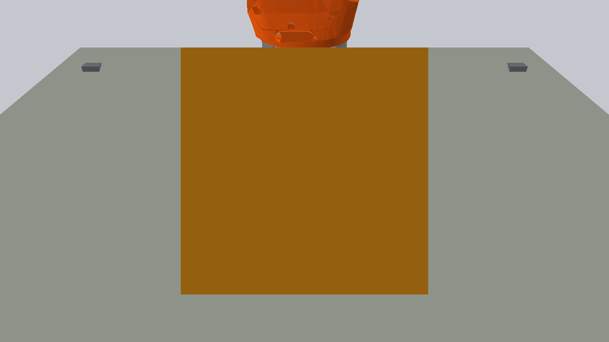
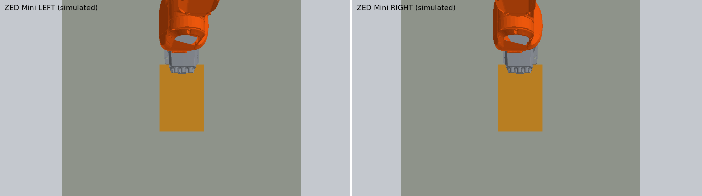

# Simulation: ABB IRB 1100 workcell in RViz2 and Gazebo

Status: **v0.1, runs in RViz2 and Gazebo (WSL, ROS 2 Jazzy).**
PDF copy: [`SIMULATION.pdf`](SIMULATION.pdf). Package: [`simulation/irb1100_vision`](../simulation/irb1100_vision) (ROS 2 Jazzy, Gazebo Harmonic).
Purpose: show the robot, the table and both cameras, so the camera views can be planned before the real setup is built.

## 1. What is in the scene

| Item | Source | Notes |
|---|---|---|
| Table | measured by the team | 1.1 m x 1.1 m square, 25 mm thick. **Top height 0.75 m is an assumption.** |
| Robot ABB IRB 1100-4/0.58, OmniCore | ABB official CAD (STEP, rev04), downloaded from [ABB's IRB 1100 page](https://new.abb.com/products/robotics/nl/onze-robots/articulated-robots/irb-1100); credit: ABB | Base at (0.20, 0.00) on the table. Link shapes, joint axes and joint positions come from the CAD. |
| Gripper Zimmer LWR50L-23-00006-A | Zimmer datasheet drawings | Approximate shapes (boxes and cylinders), **not** the exact CAD. Jaws fixed open. |
| Pallet | assumed 300 x 200 x 20 mm | The six coloured blocks were removed. |
| Camera stand | designed here | One all-printed triangle truss clamped to the table edge, upright 0.10 m outside it (see [STAND.md](STAND.md)). |
| Cam 1 (side) | placeholder | 90 x 25 x 25 mm box, **model not chosen**. Level (looks horizontally), 1.208 m high on the upright, 0.10 m outside the table edge. |
| Cam 2 (top-down) | ZED Mini datasheet | 124.5 x 30.5 x 26.5 mm, baseline 63 mm, 0.8 m above the pallet. |

Not modelled: OmniCore E10 controller box, the 3D-printed gripper adapter, gripper fingers, cables.




## 2. Robot model

- Six revolute joints with the ABB IRB 1100 axis limits (axis 1 +-230 deg, 2 -115..113, 3 -205..55, 4 +-230, 5 -125..120, 6 +-400).
- Zero pose: upper arm vertical, forearm horizontal. Flange at x = 0.364 m, z = 0.617 m from axis 1 (matches ABB's spec).
- Tool point (TCP): the jaw end face, 0.1275 m from the gripper mating face. Add the finger length for the fingertip.
- Jaws open along the tool Y axis (left-right at the zero pose).
- **Estimated, not from ABB:** link masses and inertia (21.1 kg total), torque limits, positive rotation directions (ABB convention, check on the real robot).

## 3. Cameras

| Camera | Topics (Gazebo) | Frame |
|---|---|---|
| Cam 1 | `/cam1/image_raw`, `/cam1/camera_info` | `cam1_optical_frame` |
| Cam 2 ZED Mini | `/cam2/left/image_raw`, `/cam2/right/image_raw` (+ `camera_info`) | `cam2_left_optical_frame`, `cam2_right_optical_frame` |

Simulated pictures (software preview, not the Gazebo image):




## 4. How to run (WSL Ubuntu 24.04, ROS 2 Jazzy)

```bash
sudo apt install -y ros-jazzy-rviz2 ros-jazzy-xacro ros-jazzy-robot-state-publisher \
  ros-jazzy-joint-state-publisher-gui python3-colcon-common-extensions
mkdir -p ~/ros2_ws/src && cd ~/ros2_ws/src
cp -r <repo>/simulation/irb1100_vision .
cd ~/ros2_ws && source /opt/ros/jazzy/setup.bash
colcon build --packages-select irb1100_vision && source install/setup.bash

ros2 launch irb1100_vision display.launch.py     # RViz2 + joint sliders
```

Gazebo (extra packages `ros-jazzy-ros-gz ros-jazzy-gz-ros2-control ros-jazzy-ros2-control ros-jazzy-ros2-controllers`):

```bash
ros2 launch irb1100_vision gazebo.launch.py
ros2 topic pub --once /arm_controller/joint_trajectory trajectory_msgs/msg/JointTrajectory \
 "{joint_names: [joint_1,joint_2,joint_3,joint_4,joint_5,joint_6], points: [{positions: [0.0,0.4,0.3,0.0,0.6,0.0], time_from_start: {sec: 4}}]}"
```

## 5. Known limits and open items

- Gazebo launch is untested on a real install; camera rendering in WSL may need `wsl --update`.
- Real table height, pallet position, cam 1 model, base variant (STD vs BTM) and robot variant (0.58 assumed) still need confirming.
- No inverse kinematics or motion planning (MoveIt not set up). Joints are commanded directly.
- Gripper jaws do not open or close in the model.
- No connection to the OmniCore controller; this is a visual and kinematic model only.

## 6. Where things are

| What | File |
|---|---|
| Whole scene, table, pallet, camera positions | `simulation/irb1100_vision/urdf/workcell.urdf.xacro` |
| Arm (CAD meshes, joints, limits) | `.../urdf/irb1100.xacro` |
| Gripper | `.../urdf/zimmer_lwr50l.xacro` |
| Cameras | `.../urdf/cameras.xacro` |
| Launch files | `.../launch/display.launch.py`, `gazebo.launch.py` |
