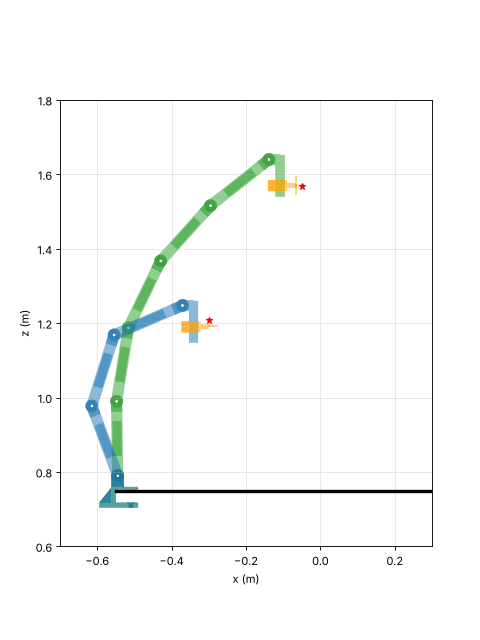

# Camera arms (all 3D printed)

Two identical-style articulated arms, clamped to the table's left edge (x = -0.55 m). Every joint is a fork and tongue hinge closed by one M8 bolt and a printed knob, so height, reach and angle can be changed by loosening the knobs.

| Arm | Position | Parts | Carries |
|---|---|---|---|
| arm2 | y = 0 | clamp + 5 links + head | Cam 2 (ZED Mini), 0.8 m above the pallet, looking down |
| arm1 | y = -0.18 m | clamp + 3 links + head | Cam 1 (side), 1.208 m high, looking along +X |

The simulation holds one fixed pose (angles in `simulation/irb1100_vision/urdf/camera_arms.xacro`, solved by `cad/gen_arms.py`). Bend the real arm differently and the cameras move; re-measure and update the pose before using the camera poses for calibration.

## Parts to print (STL in `simulation/irb1100_vision/meshes/`)

| File | Qty | Notes |
|---|---|---|
| `arm_clamp.stl` | 2 | Print on its back (flat on the lower jaw foot). Takes tables 25 to 30 mm thick. |
| `arm_link.stl` | 8 | 200 mm pivot to pivot, 234 mm long overall: place it diagonally on a 220 mm bed. |
| `arm_head.stl` | 2 | 25 x 25 mm post at the bottom: the camera mounts (`camera_mount_tilt0/90.stl`) slide over it. |
| `arm_knob.stl` | 10 | One per hinge. Hex pocket for an M8 nut. |
| `arm_clamp_knob.stl` | 2 | Hex pocket for an M10 bolt head. |

Suggested settings (not tested here): PETG, 4 perimeters, 40 % gyroid infill, 0.2 mm layers, links printed lying on their side so layers run along the bar.

## Hardware that is not printed

| Item | Qty | Use |
|---|---|---|
| M8 x 50 bolt + M8 nut (nyloc preferred) + 2 washers | 10 | one per hinge |
| M10 x 70 bolt + M10 nut | 2 | clamp screw (nut sits in the lower jaw pocket) |

If you really have no metal at all, printed M8 threads are possible but much weaker; the hinges hold by friction, so a printed bolt is the first thing to fail.

## Assembly order

1. Clamp the base on the table edge with the M10 screw (hand tight, then 1/4 turn).
2. Link 0 tongue into the clamp fork, M8 bolt through, knob on the nut side, tighten.
3. Repeat link by link, then the head. Fit the camera mount on the 25 mm post and tighten its clamp.

## Honest limits

* Friction hinges are the weak point. A rough estimate (1.5 Nm at the base hinge, about 0.3 kg of arm outboard) is within what a tightened M8 joint can hold, but this has not been measured. Arm 2 is about 1 m long: expect several millimetres of sag and some wobble. Do the hand-eye calibration with the arm in its final pose and check it again if anything is touched.
* A stiffer option if it wobbles: add a second parallel link pair, or shorten arm 2 by using a mast.
* Printed parts, strength and fit are untested. Print one link and one clamp first.
* The ZED Mini mount interface is the existing `camera_mount_tilt90.stl`; no tripod thread is used.
