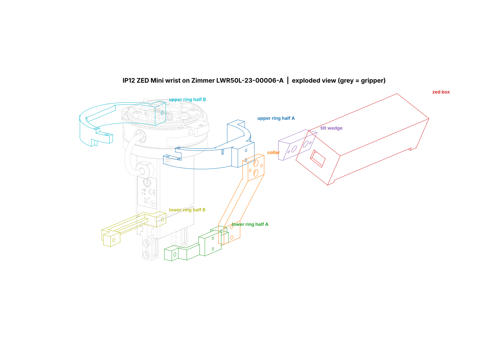
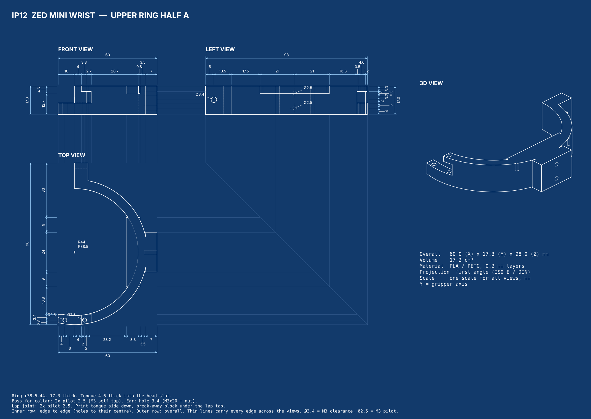
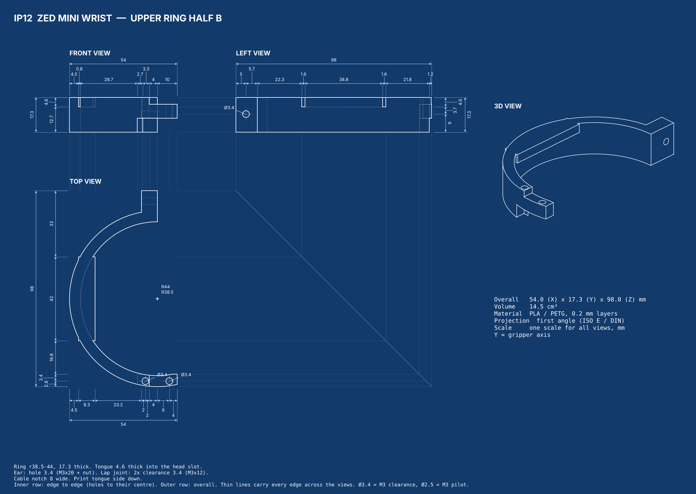
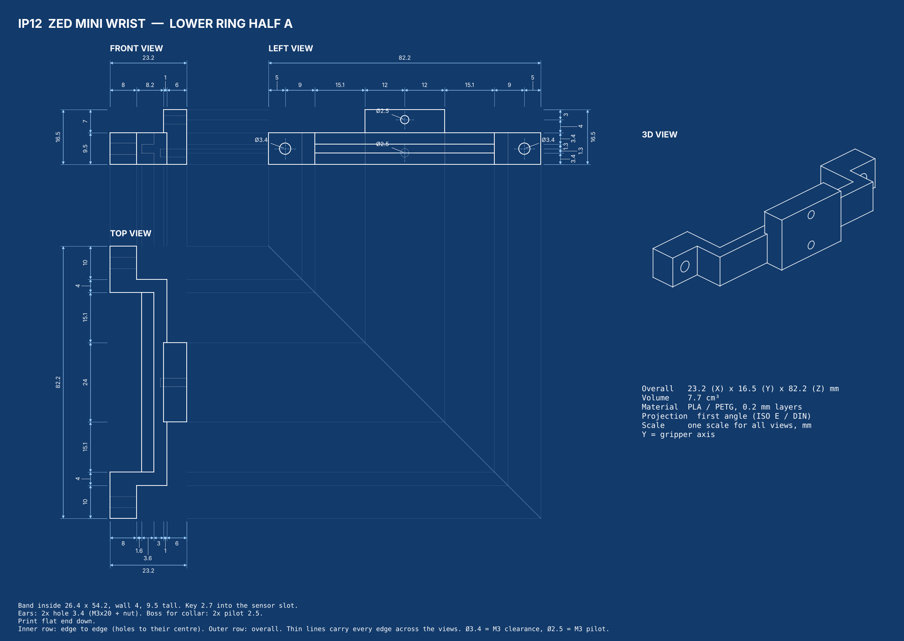
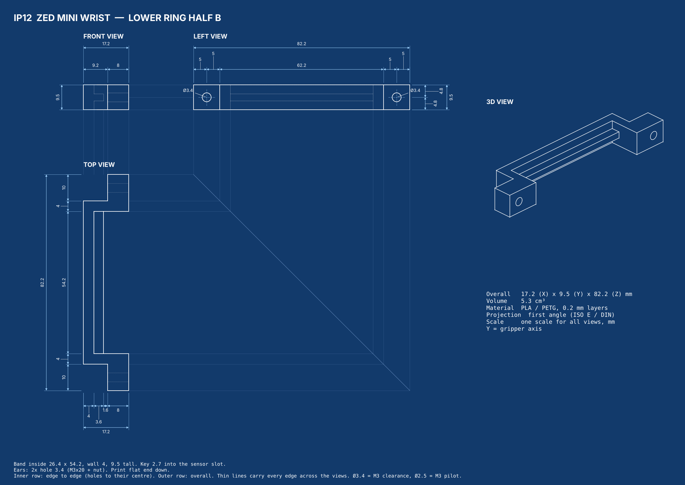
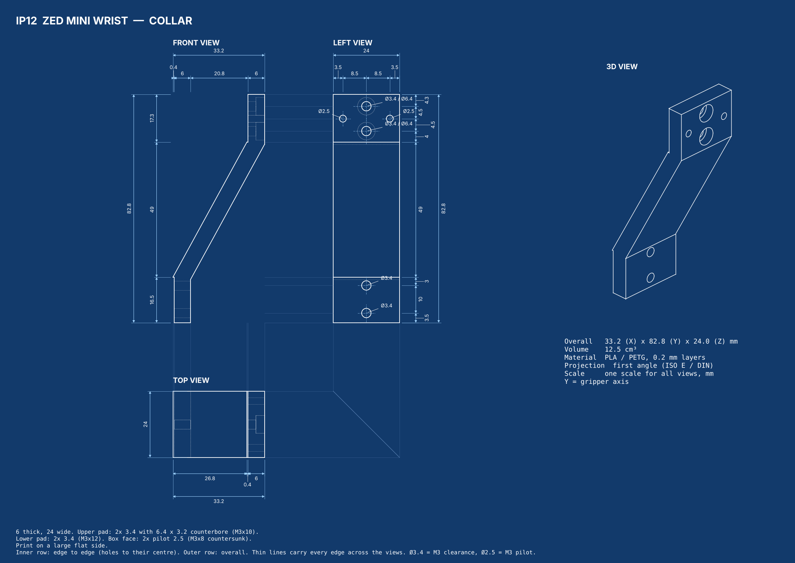
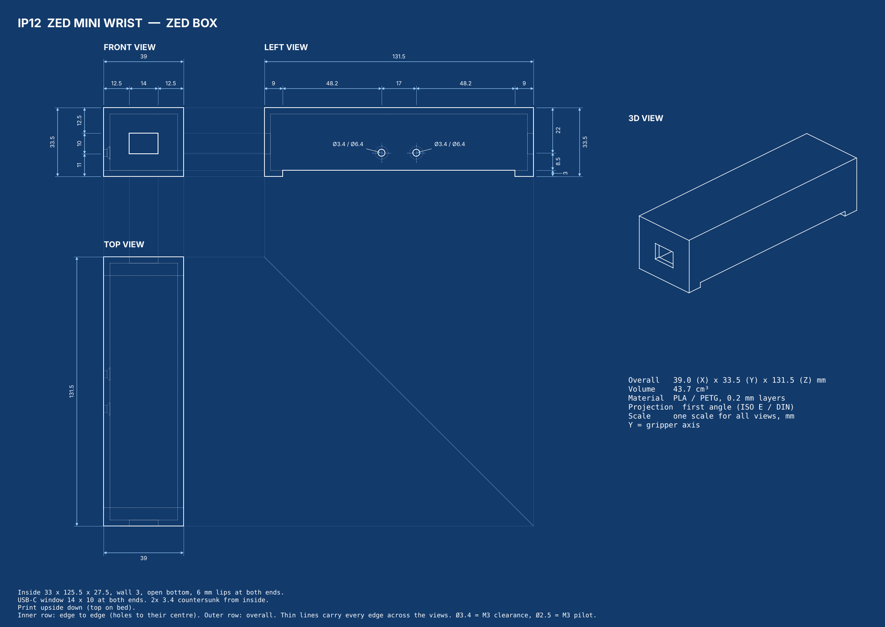

# ZED Mini wrist mount (3D printed)

Holds the ZED Mini camera on the Zimmer LWR50L-23-00002-A gripper (IO-Link). It clamps onto the gripper itself:
the upper ring locks into the two side slots of the gripper head, the lower ring keys into the two sensor slots of the body,
and a collar joins both rings and carries the camera box. The box is level, lenses pointing down.



## Parts

| Part | Files | Print orientation | Support |
|---|---|---|---|
| Upper ring half A | `upper_ring_half_A.stl/.step` | tongue side down | built-in break-away block under the lap tab (0.2 mm gap, needs 0.2 mm layers) |
| Upper ring half B | `upper_ring_half_B.stl/.step` | tongue side down | none |
| Lower ring half A | `lower_ring_half_A.stl/.step` | flat end down | none |
| Lower ring half B | `lower_ring_half_B.stl/.step` | flat end down | none |
| Collar | `collar.stl/.step` | on a large flat side | none |
| ZED box | `zed_box.stl/.step` | upside down, top on the bed | none |

The STL files are already laid flat for the slicer. The STEP files are in the assembled position (gripper coordinates, Y = gripper axis).
`gripper_with_zed_wrist_parts.step` is the whole assembly: Zimmer gripper, the six parts and a ZED Mini outline. Open it in Fusion to see the fit.
`plate_all_parts.3mf` has all six on one 220 x 220 mm bed as separate objects. Print the two upper ring halves first and check the fit
in the head slots before printing the rest.

## Screws (all M3)

| Joint | Screw | Qty |
|---|---|---|
| Ring ear joints | M3 x 20 + nut | 3 |
| Upper ring lap joint | M3 x 12 | 2 |
| Collar to upper ring (counterbored, heads sit under the box) | M3 x 10 | 2 |
| Collar to lower ring | M3 x 12 | 2 |
| Box to collar, from inside the box | M3 x 8 countersunk | 2 |

Holes: 3.4 mm = clearance, 2.5 mm = pilot for an M3 screw cut into the plastic.

## Assembly

1. Upper ring: half A from the camera side, half B from the other side, tongues into the head slots. Ear screw, then the two lap screws.
2. Lower ring: both halves around the body, keys in the sensor slots, then the two ear screws.
3. Collar onto both ring bosses.
4. Box onto the collar (screws from inside the box).
5. Camera in from below, held with a strap or foam tape (2.5 mm side play).

## Blueprints

First-angle projection (ISO E / DIN), one scale per sheet, all mm.

| | |
|---|---|
|  |  |
|  |  |
|  |  |

## Rebuild

Needs `pip install build123d trimesh matplotlib`. The scripts read the gripper CAD `LWR50L-23-00002-A.stp` in this folder
(Zimmer Group, see credits below). Then:

```bash
python3 zed_wrist_parts.py   # parts (STEP + print-ready STL), collision checks against the gripper, camera view angles
python3 blueprint.py         # blueprints/*.png
python3 drawings.py          # drawings/*.png incl. exploded view
python3 plate.py             # plate_all_parts.3mf / .stl
```

## Known limits

- Head slot height is an assumption (slot bottom 1 mm above the seam under the head, `SLOT_YC` in `zed_wrist_parts.py`). Test-print the upper ring first.
- With the box level the gripper jaws are outside the camera picture (37 deg off the lens axis at the jaw tips). Objects about 15 cm or more below the jaws are in view.
- Not test-printed yet. No nut pockets, no strap slots.

## Credits

- **Zimmer Group**: CAD model of the MATCH gripper LWR50L-23-00002-A (`LWR50L-23-00002-A.stp`, also inside `gripper_with_zed_wrist_parts.step`),
  downloaded from zimmer-group.com. All rights to the gripper and its CAD model belong to Zimmer Group. It is included only so the mount can be
  checked and rebuilt against the real gripper.
- **Stereolabs**: ZED Mini dimensions (camera outline in the assembly). All rights belong to Stereolabs.
- Mount design and scripts: this project (HSRW IP12, Pham Anh Hoang).
